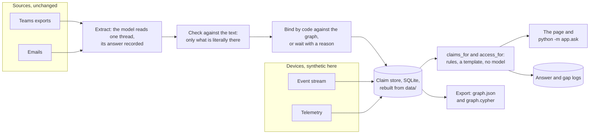

# Silent context capture for network operations

An entry for Since AI 2026 (6.11. to 8.11.2026), Elisa's challenge. The product's name is Silent
context. Working documents are in [`docs/`](docs/), and
[`CLAUDE.md`](CLAUDE.md) says where each thing lives.

## Challenge

Elisa: *Capturing and Linking Human-Generated Contextual Metadata for Autonomous Network
Operations*. What field engineers and network experts learn stays in their conversations and
emails. The task is to capture it without giving those people extra work, tie it to the right
network entities with its source and period of validity, and let an agent use it the next time a
similar case appears.

## Demo

Run it and open `http://127.0.0.1:8000`. It needs no model and no key. The arrow keys move through ten
scenes. The time axis at the top is a live version of the time-aware layers: the event stream, what was
received, and each claim's `valid_from` and `valid_to`, with `t=x` moving as the scenes go.

The demo follows three steps:

1. **Capture.** An expert's advice is taken from unchanged Teams and email exports. Nobody writes
   anything down for the system.
2. **Bind.** The advice becomes a context claim tied to graph entities, with its source, the wording
   of its scope and two separate clocks: when it holds in the world and when we learned it.
3. **Use.** In a similar case the agent proposes the right next step before anyone replaces hardware
   or reboots a unit, shows where the advice came from, and says when it does not know.

What the demo does not claim:

- The system never starts a conversation with a specialist.
- It shows the origin of a claim and what was reported about it, not the truth.
- It scores claims, not people: no personal assessment and no figure shown per person.
- Telling apart which units a claim applies to, before someone narrows it down, rests on synthetic
  data here. It is not evidence of a correct class binding in a real network.

## Architecture

The prose is in [`docs/architecture.md`](docs/architecture.md). What is real and what is simulated is
in [`docs/what-is-simulated.md`](docs/what-is-simulated.md).



## How to run

Requires [uv](https://docs.astral.sh/uv/) and Python 3.12. Settings come from environment variables
only; [`.env.example`](.env.example) lists them.

```bash
uv sync
```

```bash
cp .env.example .env
```

```bash
uv run uvicorn app.api:app
```

The page is then at `http://127.0.0.1:8000`, best viewed at 1440 by 900 or larger, and the graph as JSON
at `/graph`. The store is built from the files in `data/` on first use, and it can be rebuilt at any
time, because the only thing in it not derived from `data/` is the agent's log:

```bash
uv run python -m app.db --seed
```

To read the sources into the store, as far as the demo clock has reached:

```bash
uv run --env-file .env python -m app.ingest
```

```bash
uv run --env-file .env python -m app.ingest --until 2026-10-20T12:00:00
```

This needs no model and no key: the model's answers are recorded in `data/extractions/`, so a clean
install reads them instead of calling anything. The model is called only for a source whose prompt has
changed, or with `--refresh`, and without settings it says so. To score the result against the truth
set and the held-out binding set:

```bash
uv run --env-file .env python -m app.ingest --truth
```

To ask the agent. The agent itself uses no model, so this needs no key. `demo` runs the scripted
questions, each at its own clock value:

```bash
uv run python -m app.ask demo
```

```bash
uv run python -m app.ask claims TRN-051 "link up, counters zero after SFP replacement" --counters zero --clock 2026-10-20T12:00:00
```

```bash
uv run python -m app.ask access SITE-NILO --clock 2026-10-21T00:00:00
```

To write the graph to `export/graph.json` and, as Cypher, to `export/graph.cypher`:

```bash
uv run python -m app.export
```

The Cypher file loads into an empty Neo4j 5 database as it is. It was tried on 7.11.2026 against the
official `neo4j:5` container: every statement ran, the database held 5 claims, 14 entities, 14 evidence
events and 9 sources as nodes with all ten edge types, and one query answered the agent's question
from the graph alone. To repeat it, with any password of your own:

```bash
docker run -d --name silent-context-neo4j -p 7474:7474 -p 7687:7687 -e NEO4J_AUTH=neo4j/<password> neo4j:5
```

```bash
docker exec -i silent-context-neo4j cypher-shell -u neo4j -p <password> < export/graph.cypher
```

To run the tests:

```bash
uv run pytest
```

## What was tested

Everything below runs with no key, from the recorded answers.

- **151 tests** (`uv run pytest`): the data set's shape, the store's rules, extraction and binding
  against the truth set, the agent's acceptance cases, what devices add, the page and its endpoints.
- **The acceptance cases** of the build plan, A1 to A11, as one table:
  [`docs/acceptance.md`](docs/acceptance.md), written by `uv run python -m app.accept`. Every computed
  row holds, and a test keeps it so. A9 reports numbers only.
- **The truth set,** 11 sources: found 11/11, merged 7/7, entity 4/4, scope 4/4, time 7/7, evidence
  6/6 (`uv run python -m app.ingest --truth`).
- **The held-out binding set,** 16 synthetic sources the rule author has not read: 1 of 16 confidently
  wrong in the recorded run; 0, 0, 0, 1, 1 in five repeats with the prompt unchanged, the same file
  each time. These numbers describe this set only.
- **A clean install** from `git archive` into an empty folder, following this README with no key:
  every command above runs, on 7.11.2026.
- **The page:** all ten scenes in a browser at 1440 by 900 with no console errors.
- **The Cypher export** loaded into an empty Neo4j 5 database with no edits.

What was not tested: extraction on real conversations, outcomes read from real chat, and the class
binding on anything but this synthetic data ([`docs/what-is-simulated.md`](docs/what-is-simulated.md)).

## Product and running environment

The product is the code and data in this repository. It runs on your own infrastructure: the model
endpoint is an environment variable and accepts any OpenAI-compatible service, and nothing depends
on the author's machines or accounts.

The tools used to build it and the environment the demo was recorded in are not part of the product.

The recorded answers came from Claude Opus 5.5 through Anthropic's OpenAI compatibility layer.
Anthropic describes that layer as intended for testing and comparing models, not as a long-term
production solution, so a production deployment should choose its endpoint accordingly.

## Pre-existing work

Commit 1 (4.11.2026) is a scaffold created before the event; everything after it was built at Since AI 2026.

## AI tools used

| Tool | Used for |
|---|---|
| Claude Code (Claude Opus 5.5; Claude Fable 5.1 from 7.11.) | Creating the scaffold in commit 1; writing the code, the synthetic data and the documentation at the event |
| Claude (Fable 5.1) on claude.ai | Analysing the challenge material; writing the decision document and the build plan |
| Claude Opus 5.5 and GPT 6.1 in structured multi-agent rooms | Generating ideas (3 rooms) and challenging the design decisions (6 rooms); the owner made the decisions |
| Claude Opus 5.5 through the API | Part of the demo, not of building it: reads the sources for the extraction whose answers are in `data/extractions/` |

## Synthetic data

Most of the data is synthetic, as Elisa's ground rules allow. What was generated and how:
[`docs/synthetic-data.md`](docs/synthetic-data.md).

## Open-source components and licences

Direct dependencies, licences read from the installed package metadata:

| Component | Licence | Used for |
|---|---|---|
| FastAPI | MIT | HTTP interface |
| Uvicorn | BSD-3-Clause | Application server |
| OpenAI Python SDK | Apache-2.0 | Client for any OpenAI-compatible endpoint |
| Pydantic | MIT | The extraction's schema and its validation |
| pytest | MIT | Tests (development only) |
| HTTPX | BSD-3-Clause | Test client (development only) |

## Data and IP (challenge terms)

**Data.** Elisa's example conversation and email are included unchanged. Elisa states that its names,
node IDs and messages are illustrative and that they contain no production, customer or personal
data. Everything else is synthetic. No Elisa system was accessed. Elisa's challenge brief is not
included in this repository.

**IP.** Under the challenge terms the team owns what it builds, and Elisa can use it in its business.
No licence has been chosen for this repository yet.
